<p align="center">
  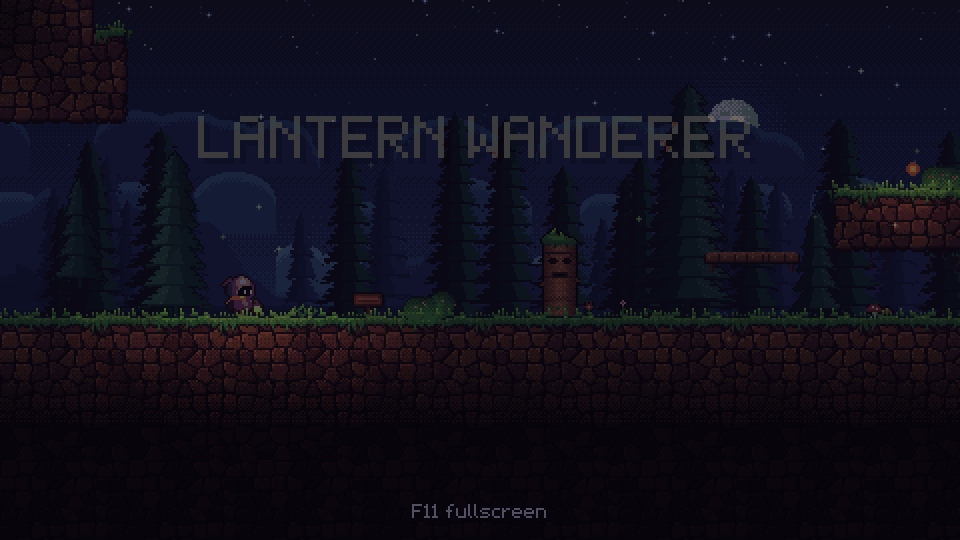
</p>

<h1 align="center">Lantern Wanderer</h1>

<p align="center"><i>A small light, a long way down.</i></p>

<p align="center">
  
  
  
  
  <a href="LICENSE"></a>
</p>

A 2D pixel-art adventure about carrying a light. You are a hooded wanderer holding the last
ember in the mountain. Take it down through crystal caves, drowned halls and the roots of the
world to rekindle the dying Hearth, and decide, one person at a time, how much of your warmth
to give away.

## The game

- **Light is the mechanic.** Your lantern makes glimmer solid, wakes the Keepers' eye-stones,
  holds back the shades and casts the shadows you solve puzzles with.
- **Sharing costs you.** Every ember you give away makes your light smaller, and changes who
  stands beside you at the end. Four endings.
- **Echoes.** Three playable memories of those who went down before you, each with one rule
  that changes what light means.
- **A home that fills up.** Everyone you warm moves to Old Hollow, where they eat supper
  together and their stories keep moving.

<p align="center">
  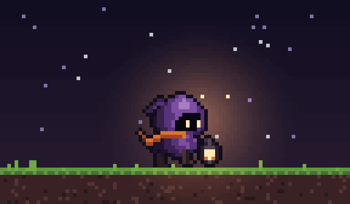<br>
  <sub>The wanderer's scarf is their wick. It burns a little shorter every chapter.</sub>
</p>

## Gallery

<table>
  <tr>
    <td width="50%">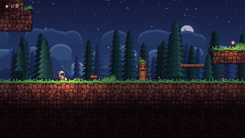<br>
      <sub><b>Mossgrave Woods.</b> Where the walk down begins.</sub></td>
    <td width="50%">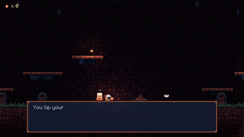<br>
      <sub><b>Old Hollow.</b> Give an ember away, and the Little Hearth catches.</sub></td>
  </tr>
  <tr>
    <td>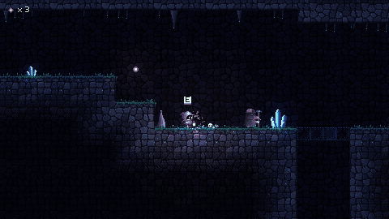<br>
      <sub><b>The Glimmerdeep.</b> Glimmer turns solid in your light.</sub></td>
    <td>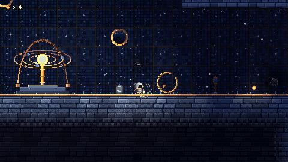<br>
      <sub><b>The Starwell.</b> A sunken observatory and its Great Orrery.</sub></td>
  </tr>
  <tr>
    <td>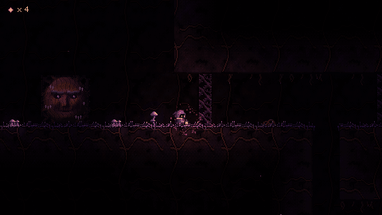<br>
      <sub><b>The Rootdark.</b> The Flare burns a way through the thorn-roots.</sub></td>
    <td>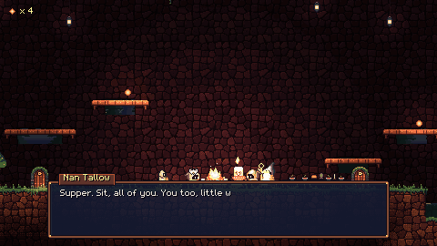<br>
      <sub><b>Supper.</b> The people you warmed, round one fire.</sub></td>
  </tr>
  <tr>
    <td>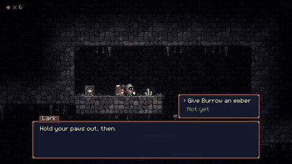<br>
      <sub><b>Echo: Lark's Song.</b> Warm someone, and they light the way.</sub></td>
    <td>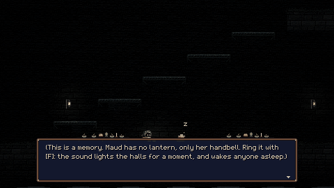<br>
      <sub><b>Echo: The Last Winter.</b> No lantern, only a bell, and the water rising.</sub></td>
  </tr>
</table>

<details>
<summary><b>Spoilers: the bottom of the mountain</b></summary>
<br>
<table>
  <tr>
    <td width="50%">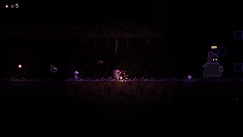<br>
      <sub><b>The Hollow One.</b> The first wick, who turned back.</sub></td>
    <td width="50%">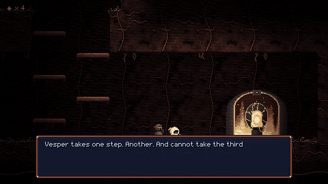<br>
      <sub><b>Echo: Vesper.</b> The step that wouldn't come.</sub></td>
  </tr>
  <tr>
    <td>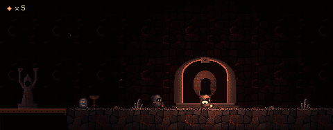<br>
      <sub><b>Many Hands.</b> Everyone you warmed comes down to give your ember back.</sub></td>
    <td>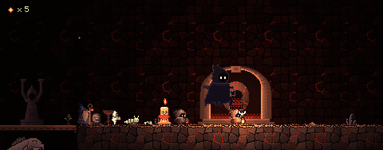<br>
      <sub><b>The First Page.</b> The hidden fourth ending.</sub></td>
  </tr>
</table>
</details>

## Tech stack

| Layer | Built with |
|---|---|
| Engine | **Godot 4.7** and GDScript (58 scripts, ~9.4k lines), GL Compatibility renderer |
| Rendering | 480×270 viewport with integer scaling; real-time 2D lights in the dark (`PointLight2D`, `CanvasModulate`); a screen-reading shader for the Echoes' memory filter and Vesper's fear |
| Levels | Plain-text ASCII maps, parsed at load into tiles, props, lights and characters. Shadow-puzzle geometry is worked out in Python |
| Story | Data-driven dialogue (~780 lines) with conditions, choices, story flags and cutscene events |
| Art | **Python + Pillow**: every sprite, tile, backdrop, UI piece and the pixel font, drawn by code in one shared palette (~200 images) |
| Audio | **NumPy + soundfile**: 18 music tracks, 9 ambiences, 45 effects and 20 character voices, all synthesized |
| Tooling | A command-line test harness (warp, scripted input, screenshots, frame recording) for headless checks; the GIFs above were filmed with it. One-click Windows export |

No asset packs: every image and sound in the game comes from the scripts in [`art_src/`](art_src).

## Play it

**From source** with [Godot 4.7](https://godotengine.org/download):

```sh
git clone https://github.com/meshvelianitemo/lantern-wanderer.git
cd lantern-wanderer
godot --headless --path . --import   # first time only: imports the assets
godot --path .
```

**As a standalone Windows `.exe`:** run `export.bat` (set the Godot path at its top, and install
the 4.7 export templates). It builds `export/LanternWanderer.exe`, one file that runs on any
64-bit Windows PC with nothing to install.

| | Keyboard | Gamepad |
|---|---|---|
| Move | A / D, arrows | Left stick, D-pad |
| Jump | Space, W, Z | A |
| Talk / interact | E, X, Enter | X / B |
| Flare | F, Shift | Y / RB |
| Journal | Tab | Select |
| Pause | Esc | Start |

Every key can be rebound in **Options > Controls**.

## Project layout

```
scripts/         game code: player, level loader, dialogue, light mechanics, UI
scripts/story/   all dialogue, one file per chapter
levels/          the maps, as ASCII text
shaders/         the memory filter
art_src/         Python that generates every image and sound in assets/
media/gifs/      the GIFs on this page
```

More: [DESIGN.md](DESIGN.md) (the design bible; spoilers),
[DEVELOPMENT.md](DEVELOPMENT.md) (debug flags, adding content, the asset pipeline),
[PLAYTEST.md](PLAYTEST.md) (playtest and release checklist).

## Credits

Made by **Temo Meshveliani**. Built with [Godot Engine](https://godotengine.org).
Released under the [MIT License](LICENSE).
